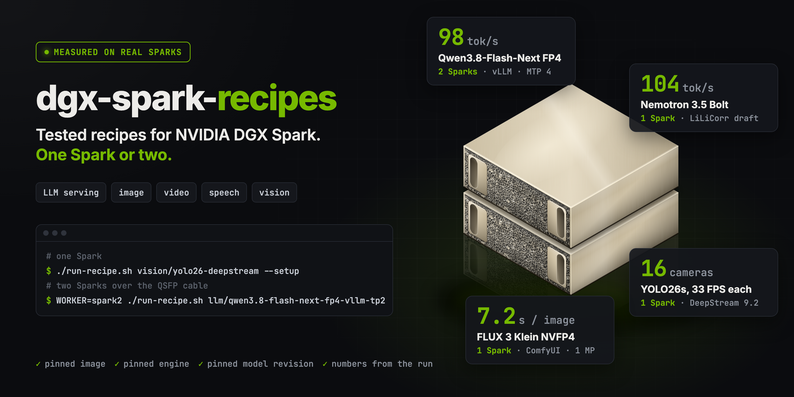

# DGX Spark recipes

Recipes for the NVIDIA DGX Spark (GB10, 128 GB unified memory), on one Spark or two: LLM serving, image,
video and speech, and vision (detection and tracking on video). Each one was run and measured on Sparks.

Every recipe:
- pins the container image, the engine version and the model revision
- ships with the numbers it was measured at
- runs without host changes: read-only model cache, no added privileges, output in `./out`

Not affiliated with NVIDIA or any model maker. Each model keeps its own license.

## Quick start

```bash
git clone https://github.com/atakann/dgx-spark-recipes
cd dgx-spark-recipes
./run-recipe.sh image/qwen-image-2.1-turbo --setup
```

`--setup` builds the image and downloads the model at the pinned revision. Leave it out
on later runs. Script arguments go after `--`:

```bash
./run-recipe.sh image/qwen-image-2.1-turbo -- --prompt "a red fox in fresh snow" --seed 7
```

Needs Docker with the NVIDIA runtime (DGX OS has both) and the `hf` CLI for `--setup`.

## Recipes

A recipe is `recipes/<task>/<name>.yaml` and runs as `./run-recipe.sh <task>/<name>`.
LLM recipe names end in the engine. Server recipes start in the background and serve on port 8000
(`HOST`, `PORT` to change).

Two-Spark recipes (`Sparks` 2) run from the first Spark and start the second one over ssh. Set `WORKER` to the
second Spark's ssh host (key login, same user); the QSFP link, its RoCE devices and the head's address are found
on each Spark. `--setup` copies the image to the worker and downloads the model there too; `--stop` stops both.

```bash
WORKER=spark2 ./run-recipe.sh llm/qwen3.8-flash-next-fp4-vllm-tp2 --setup
WORKER=spark2 ./run-recipe.sh llm/qwen3.8-flash-next-fp4-vllm-tp2 --stop
```

### LLM servers (`llm/`)

| recipe | model | engine | Sparks | one user |
|---|---|---|---|---|
| `ornith-1.5-122b-q4km-llamacpp` | Ornith-1.5-122B, Q4_K_M GGUF | llama.cpp v0.7.0, built for sm_121 | 1 | 28.2 tok/s |
| `ornith-1.5-122b-nvfp4-vllm` | Ornith-1.5-122B, NVFP4 | vLLM nightly 77154ca | 1 | 26.5 tok/s, prefill 2,447 tok/s |
| `nemotron-3.5-bolt-vllm` | Nemotron 3.5 Bolt 74B, 2-bit QAD | vLLM nightly 77154ca + b12x | 1 | 29 tok/s |
| `nemotron-3.5-bolt-lilicorr-vllm` | same, with NVIDIA's LiLiCorr draft | vLLM nightly 77154ca + b12x | 1 | 93-104 tok/s on code, JSON, rewrites |
| `qwen3.8-flash-next-fp4-vllm` | Qwen3.8-Flash-Next FP4-Local (NVIDIA's QAD NVFP4), MTP 4 | vLLM 8244d1c (eugr/spark-vllm-b12x) | 1 | 49-64 tok/s on JSON, code, rewrites, explanations |
| `qwen3.8-flash-next-fp4-flare` | same model, MTP 5 | NVIDIA Flare 5f37bd1 (research prototype) | 1 | 42-66 tok/s on JSON, rewrites, code, explanations |
| `qwen3.8-flash-next-fp4-vllm-tp2` | same model, MTP 4, TP=2 (NVIDIA's cluster command) | vLLM 8244d1c (eugr/spark-vllm-b12x) | 2 | 74-98 tok/s on JSON, code, rewrites, explanations |
| `glm-5.3-flash-fp4-vllm-tp2` | GLM-5.3-Flash FP4-Local (NVIDIA's QAD NVFP4), MTP 5, TP=2 (the card's command) | vLLM 8244d1c (eugr/spark-vllm-b12x) | 2 | 31 tok/s, 55 for four users |
| `glm-5.3-flash-fp4-tensorfold-tp2` | same weights, TP=2 (TensorFold's GLM recipe) | TensorFold 1.1.9 release | 2 | 44-48 tok/s on JSON, code, rewrites |
| `qwen3.8-27b-nvfp4-bf16head-vllm` | Qwen3.8-27B, NVFP4 with a BF16 lm_head ([atakans](https://huggingface.co/atakans/Qwen3.8-27B-NVFP4-BF16head)) | vLLM 0.30.0 | 1 | 11.1 tok/s |
| `nanbeige4.3-33b-nvfp4-dflash2-vllm` | Nanbeige4.3-33B, NVFP4 (primitive-ai), with ProCreations' DFlash2 draft | vLLM nightly 77154ca + b12x | 1 | 22-24 tok/s on JSON and code, 11.3 without the draft |
| `ling-3.0-flash-mxfp4-sglang` | Ling-3.0-flash 124B-A5B, MXFP4 (inclusionAI), MTP 3, FP8 lm_head, FlashInfer MoE | SGLang 20621aa + inclusionAI 079d404 | 1 | 51-57 tok/s on JSON, code, rewrites |
| `ling-3.0-flash-fp8-sglang-tp2` | Ling-3.0-flash, FP8 (inclusionAI), MTP 3, FP8 lm_head, TP=2 | SGLang 20621aa + inclusionAI 079d404 | 2 | 72-80 tok/s on JSON, code, rewrites, explanations |
| `nemotron-3.5-super-vl-nvfp4-lilicorr-vllm` | Nemotron 3.5 Super VL 120B-A12B, NVFP4 (NVIDIA), vision-language, with NVIDIA's LiLiCorr draft | vLLM 0.32.0 | 1 | 62-71 tok/s on JSON, code, rewrites |
| `ripple-65b-preview-nvfp4-dflash2-vllm` | Ripple-65B Preview, dense, NVFP4 (Ricursive), with Ricursive's DFlash2 draft | vLLM nightly 4fab5a07 | 1 | 18-29 tok/s on JSON, code, rewrites; 7.7 on stories |
| `qwen3.8-27b-bf16-dspine-sglang` | Qwen3.8-27B, BF16, with Tencent's DSpine draft (16 tokens), patched for GPUs without FA3 | SGLang 0.5.22 + DSpine 0cc92d8 | 1 | 29-31 tok/s on JSON, code, rewrites; 8 on stories |
| `arete-27b-nvfp4-vllm` | Arete-27B (Nous Research's Qwen3.8-27B fine-tune), NVFP4 ([atakans](https://huggingface.co/atakans/Arete-27B-NVFP4)) | vLLM nightly 4fab5a07 | 1 | 13.2 tok/s, 9.1 at 128K |

### Image (`image/`)

| recipe | model | engine | Sparks | time |
|---|---|---|---|---|
| `qwen-image-2.1-turbo` | Qwen-Image 2.1 Turbo, BF16, 8 steps | diffusers 0.41.0 | 1 | 55.5 s per 2048² image |
| `qwen-image-2.1-base` | Qwen-Image 2.1, BF16, 40 steps | diffusers 0.41.0 | 1 | 257 s per 2048² image |
| `flux-3-klein` | FLUX 3 Klein, BF16 and NVFP4 | ComfyUI v0.41.0 | 1 | 7.2 s per 1 MP image (NVFP4) |
| `minimax-h3-image-sglang` | MiniMax-H3-Image, BF16, 6 steps (server) | SGLang nightly 7e31007a | 1 | 81 s per 4096² image, 16 s per 2048² |

### Video (`video/`)

| recipe | model | engine | Sparks | time |
|---|---|---|---|---|
| `fasth3-qad` | FastH3-QAD-v2, NVFP4, video with sound | FastVideo d4f1445 | 1 | 8.1 min for 10 s of 1344×768 |
| `ltx-2.5-distilled` | LTX-2.5 22B distilled, BF16, video with sound (Lightricks, gated) | LTX-2 4f52161 | 1 | 5.3 min for 10 s of 1344×768 |

### Speech (`speech/`)

| recipe | model | engine | Sparks | speed |
|---|---|---|---|---|
| `drama-3` | Fish Audio Drama 3, text to speech | SGLang-Omni 22d4ace | 1 | 1.1× real time, one request |
| `nemotron-3.5-transcribe-fp8` | NVIDIA Nemotron 3.5 Transcribe 30B-A4B, FP8, speech to text with word timestamps and speakers | vLLM 0.32.0 + NeMo Speech 2ed70ab | 1 | 29× real time, WER 11.19 on Earnings-22 |
| `nemotron-3.5-transcribe-nvfp4` | same model, NVFP4 | vLLM 0.32.0 + NeMo Speech 2ed70ab | 1 | 33× real time, WER 11.85 on Earnings-22 |

### Vision (`vision/`)

| recipe | model | engine | Sparks | speed |
|---|---|---|---|---|
| `yolo26-tensorrt` | YOLO26s, TensorRT FP16, ByteTrack, one video | Ultralytics 8.4.192, TensorRT 11.2.1.2 | 1 | 164 FPS on a 1080p 30 FPS clip |
| `yolo26-deepstream` | YOLO26s, TensorRT FP16, NvSORT, N videos in one pipeline | DeepStream 9.2, TensorRT 10.16.1 | 1 | 16 videos at 33.4 FPS each |

## CHANGELOG

### 2026-11-14

#### MiniMax-H3-Image: a 4096×4096 image in 81 s

`image/minimax-h3-image-sglang` serves MiniMax-H3-Image (a 33.1B DiT, distilled to 6 steps, text to image and image
editing) on SGLang's nightly image of 2026-11-13, pinned by digest and used as it ships. Everything stays on the GPU
in BF16; SGLang precomputes the AdaLN projections on the GB10 and asks for 106 GiB of available memory at the start,
so run it with nothing else loaded. The text encoder is the one of MiniMax-H3: `--setup` downloads 69 GB of the
204 GB image repo and the 67 GB `text_encoder/` folder of `MiniMaxAI/MiniMax-H3`. For this a recipe can now give
`include:` glob patterns, and `extra:` with `extra_revision:` and `extra_include:` for a second repo (`{extra}` in
`args`).

The model's license (MiniMax-H3-Image Community License) does not cover the EU, the UK, South Korea and the US.

Measured on one Spark from this command: the server is ready 8.3 min after the start; a 4096×4096 image takes
81-82 s and a 2048×2048 one 15.9 s (warm requests, with the PNG). The first request compiles kernels and takes 70 s
at 2K. Lowest free memory 22.8 GiB. SGLang's own cookbook gives 16.2 s at 2K and 85 s at 4736×3552 for the Spark.

```bash
./run-recipe.sh image/minimax-h3-image-sglang --setup
curl -s http://127.0.0.1:8000/v1/images/generations -H 'Content-Type: application/json' \
  -d '{"prompt": "a red fox in fresh snow, documentary photo", "size": "4096x4096", "seed": 7, "response_format": "b64_json"}' \
  | jq -r '.data[0].b64_json' | base64 -d > fox.png
./run-recipe.sh image/minimax-h3-image-sglang --stop
```

Not in the recipe: `--quantization mxfp8 --component-quantizations.text_encoder mxfp8` (online MXFP8) gave 65-69 s at
4096×4096 and 11.8 s at 2K in the lab, with 49.8 GiB free; the same seed then gives the same scene with other details.

### 2026-11-10 (2)

#### LTX-2.5 distilled: 10 s of video with sound in 5.3 minutes

`video/ltx-2.5-distilled` runs Lightricks' LTX-2.5 (a 22B audio and video DiT) with its distilled transformer in BF16,
the Gemma text encoder, the video and audio VAEs and the x2 spatial upscaler, through Lightricks' own
`ltx_pipelines.distilled` at 4f52161 (8 steps, the upscale, 3 more steps). `images/ltx` is the README's install with
Python pinned to 3.12. The repo is gated: accept the terms on its Hugging Face page and log in with `hf auth login`
before `--setup`, which downloads only these five files (71 GB). `file:` in a recipe now takes a space-separated list.

The HF cache keeps each file as a symlink to a blob with no extension, and the pipeline resolves the paths and then
rejects the text encoder for not ending in `.safetensors`; `scripts/ltx.py` keeps the paths as given.

Measured on one Spark from this command: 10 s of 1344×768 at 24 fps (241 frames) with sound from the Tokyo prompt in
the script, 5.3 min from start to file, lowest free memory 71.8 GiB. The same prompt took FastH3-QAD-v2 8.1 min.

```bash
./run-recipe.sh video/ltx-2.5-distilled --setup
./run-recipe.sh video/ltx-2.5-distilled -- --prompt-file out/my-prompt.txt --seconds 5
```

### 2026-11-10

#### Arete-27B in NVFP4 on one Spark

`llm/arete-27b-nvfp4-vllm` serves `atakans/Arete-27B-NVFP4`, my NVFP4 build of Nous Research's Arete-27B (a fine-tune
of Qwen3.8-27B), on the same vLLM nightly as the Ripple recipe. I quantized it with ModelOpt 0.48.0 and NVIDIA's recipe
for Qwen3.8-27B: MLP and lm_head in NVFP4, attention in FP8, 20 GB against 55 GB in BF16. Arete has no MTP weights, so
there is no draft.

Measured from a clean start, one user, temperature 0.7, 300 tokens, thinking off, best of 5: 13.2 tok/s on JSON, code,
rewrite, explain and story. Ready 6.3 minutes after the command with the download (3.0 minutes from the server start);
lowest free memory 65.3 GiB. In the lab: 11.8 tok/s at 32K, 9.1 at 128K, a 128K prompt read in 82 s and the second turn
in 1.1 s; GPQA Diamond 80.3% and IFEval 83.0%, against 81.8% and 85.5% for BF16, thinking off.

```bash
./run-recipe.sh llm/arete-27b-nvfp4-vllm --setup
```

### 2026-11-09

#### Qwen3.8-27B with Tencent's DSpine draft, on a GPU without FA3

`llm/qwen3.8-27b-bf16-dspine-sglang` serves Qwen3.8-27B in BF16 with `tencent/Qwen3.8-27B-DSpine-b16`, a five-layer
draft that proposes 16 tokens per block, on SGLang 0.5.22 with Tencent's DSpine plugin. The plugin requires FA3 for
the draft attention, and the GB10 has no FA3. `images/dspine` applies `gb10.patch` (3 files): the draft attention runs
on Triton, and the ragged verify graph that batches of 8 use is skipped when the backend cannot capture it. With
FlashInfer as the draft attention backend the output was garbage, so the patch allows Triton only. The command is
Tencent's Qwen3.8-27B command with Triton attention, 0.70 of the memory and no `--trust-remote-code`.

Measured from a clean start, one user, temperature 0.7, 300 tokens, thinking off, best of 5: JSON 30.5, code 30.6,
rewrite 29.0, explain 16.3, story 8.0 tok/s. In the lab, on the same setup, z-lab's DFlash2 draft (8 tokens) gave JSON
23.4, code 23.6, rewrite 19.2, explain 18.6, story 10.3, and no draft 4.5 on every prompt. The long blocks win on
structured text and lose on prose. Greedy answers to six prompts: DFlash2 matched no draft byte for byte on all six,
DSpine on four; on the other two it picked a different token at a near tie ("cliff" for "rock", the other JOIN order).
Without DSpine's ReplaySSM the server does not fit in memory, so the source of the difference is not isolated. Ready
10.3 minutes after the command; lowest free memory 21.6 GiB.

```bash
./run-recipe.sh llm/qwen3.8-27b-bf16-dspine-sglang --setup
```

### 2026-11-08

#### Ripple-65B Preview on one Spark, with Ricursive's DFlash2 draft

`llm/ripple-65b-preview-nvfp4-dflash2-vllm` serves Ricursive's NVFP4 build of Ripple-65B Preview (a dense 65B model:
64 sliding-window and 16 full-attention layers) with Ricursive's DFlash2 draft, 7 tokens, on a vLLM nightly image
pinned by digest. Ripple is in-tree in vLLM since PR #65745, so there is no `--trust-remote-code` and the repo's `.py`
files are not used. 256K window with a 24 GiB KV cache (64 KiB per token on the full-attention layers). The model has
no switch for thinking: it decides per turn. The repo ships no sampling defaults; temperature 0.6 and top_p 0.95 are
our choice.

Measured from a clean start, one user, temperature 0.7, 300 tokens, best of 5: JSON 17.9, code 21.1, rewrite 28.9,
explain 11.7, story 7.7 tok/s; the draft lands about 5-7 tokens a step on structured text and 2 on stories. It is a
dense model, so prose without help from the draft is slow. In the lab run decode held 8.2 tok/s at 32K context and 7.1
at 128K, where the prompt read in 204 s. GPQA Diamond 69.2% and IFEval 90.0% at temperature 0 with a 16K-token cap;
49 of 198 GPQA answers and 14 of 200 IFEval answers hit the cap and count as wrong. Ready 4.4 minutes after the
command; lowest free memory 25.0 GiB.

```bash
./run-recipe.sh llm/ripple-65b-preview-nvfp4-dflash2-vllm --setup
```

### 2026-11-03

#### Nemotron 3.5 Super VL on one Spark, with NVIDIA's LiLiCorr draft

`llm/nemotron-3.5-super-vl-nvfp4-lilicorr-vllm` serves NVIDIA's NVFP4 build of Nemotron 3.5 Super VL (120B total,
12B active; Mamba-2, MoE and attention layers with a vision encoder) with the LiLiCorr DFlash draft, from the model
card's DGX Spark command on the official vLLM 0.32.0 image. Two changes keep 10+ GiB free: 0.70 of the memory instead
of 0.75 (the first start's MoE autotune took 0.75 down to 8.5 GiB) and a 256K window instead of 1M (1M needs 10 GiB of
KV cache that 0.70 does not leave). `--trust-remote-code` stays, because vLLM's own config for this model lacks fields
the repo's config code adds; the repo's 8 `.py` files at the pinned revision hold config and image processing code
only. The first start is ready about 12 minutes after the command.

Measured from a clean start, one user, thinking off, temperature 0.7, median of 5: JSON 71.2, code 64.0, rewrite
62.3, explain 44.6, story 30.1 tok/s; the draft lands about 6-7 tokens a step on structured text and 3 on prose.
In the lab run decode held 33 tok/s at 32K context and 29 at 128K, where the prompt read in 53 s. A document page as
an image was read and answered in 5.5 s. Lowest free memory 20.2 GiB.

```bash
./run-recipe.sh llm/nemotron-3.5-super-vl-nvfp4-lilicorr-vllm --setup
```

### 2026-11-02

#### Nemotron 3.5 Transcribe on one Spark, FP8 and NVFP4

`speech/nemotron-3.5-transcribe-fp8` and `speech/nemotron-3.5-transcribe-nvfp4` serve NVIDIA's quantized
Nemotron 3.5 Transcribe (30B MoE, 4B active) on vLLM 0.32.0 with the NeMo Speech plugin, built from NeMo Speech's
own `uv.lock` (`images/nemotron-transcribe`). The flags are the model card's, without `--trust-remote-code` (the
repos have no code), with 8 sequences and 0.62 of the memory. NVIDIA's timestamp middleware is on, so a reply
can carry word times and speaker tags.

Measured on three Earnings-22 calls from the Open ASR long-form set (61 min of audio, one call at a time, warm),
scored with the leaderboard's normalizer:

| build | WER | 61 min of audio in | lowest free memory |
|---|---|---|---|
| BF16 (not a recipe) | 11.42 | 188 s, 20× real time | |
| FP8 | 11.19 | 126 s, 29× | 32 GiB |
| NVFP4 | 11.85 | 110 s, 33× | 36 GiB |

`scripts/nemotron-transcribe.py` sends one WAV with NVIDIA's speaker-tag prompt and writes the reply as `.json`
and `.srt`. A 65 s film scene with two speakers took 5.0 s (FP8) and 4.2 s (NVFP4). In long one-speaker
stretches (a 20 min call) NeMo's aligner drops most word times without an error; the transcript stays complete,
and the script says when the times cover less than 90% of the words. The first start compiles kernels into
`./cache` (about 21 min), later starts take about 7 min, and the first request after a start about 40 s.

```bash
./run-recipe.sh speech/nemotron-3.5-transcribe-fp8 --setup
ffmpeg -i film.mp4 -vn -ac 1 -ar 16000 film.wav
python3 scripts/nemotron-transcribe.py film.wav
```

### 2026-11-01

#### Qwen3.8-Flash-Next on one Spark: a safe start

`llm/qwen3.8-flash-next-fp4-vllm` loaded its weights with `--load-format b12x`, from NVIDIA's DGX Spark command.
Measured at one-second steps, that loader took MemAvailable under 1 GiB (0.7-1.0 GiB) for about two seconds at
the end of the load in all three starts we logged, with nothing else running on the Spark; on a first start the
b12x kernel compile then took it down again. The recipe now uses vLLM's own loader and one b12x compile worker (`env: B12X_COMPILE_WORKERS=1`):
lowest free memory 17.1 GiB on the first start and 18.0 GiB on later starts, at about the same speed (JSON 64,
code 58, rewrite 60 tok/s; 68, 62 and 47 on 10-23). Starts take longer: 32 min the first time, 12 min after. `run-recipe.sh` now passes a recipe's
`env:` to one-Spark servers too. If you ran this recipe before, pull and restart it.

#### GLM-5.3-Flash FP4-Local on two Sparks with TensorFold

`llm/glm-5.3-flash-fp4-tensorfold-tp2` serves the same `nvidia/GLM-5.3-Flash-FP4-Local` weights as the vLLM
recipe with TensorFold 1.1.9's signed release binary, following TensorFold's own GLM recipe
([docs/recipes/glm-5.3-flash-cuda.md](https://github.com/ashhart/TensorFold/blob/v1.1.9/docs/recipes/glm-5.3-flash-cuda.md),
Apache-2.0). `images/tensorfold` downloads the release archive, checks its sha256 and the archive's own
`SHA256SUMS`, and puts it on NGC PyTorch (by digest) for CUDA 13, NCCL and verbs. `run-recipe.sh` gains
`engine: tensorfold` (both ranks get the same flags; `TF_GLM_RANK`, `TF_GLM_WORLD` and `NCCL_COMM_ID` place them)
and a `cpuset:` key. This recipe pins each rank to GB10's efficiency cores (0-4, 10-14), as TensorFold's runbook
advises, and reserves 17 GiB with a 147,456-token window, so 15+ GiB stays free on each Spark.

Measured from a clean start with the command below, one user, reasoning effort low, temperature 0.7, median of 5:
JSON 48.1, code 48.2, rewrite 44.4, explain 39.8, story 33.4 tok/s; the low point was 15.9 GiB free. Lab runs with
the same settings were 5-15% faster on most prompts (cause not found); there a 128k prompt read in 91 s and turn 2
came from TensorFold's prompt cache in about 1 s. Against the vLLM recipe on the same weights, one user is faster on
most prompts and four users are level.

```bash
WORKER=spark2 ./run-recipe.sh llm/glm-5.3-flash-fp4-tensorfold-tp2 --setup
```

### 2026-10-31

#### YOLO26 on video: Ultralytics with TensorRT, and DeepStream

Two recipes detect and track objects in video with `yolo26s.pt` from `Ultralytics/YOLO26` (the same file as
Ultralytics' GitHub release, sha256 `646f8bc3`). By default both run DeepStream's 1080p 30 FPS H.264 sample
clip (1443 frames); `-- --source out/<file>` takes your own video from `./out`. Both use TensorRT FP16: on the
Spark, INT8 is not faster than FP16 for YOLO26n, s and m at batch 1, and it loses 1.1 to 1.8 mAP on COCO val2017.

`vision/yolo26-tensorrt` exports the model to a TensorRT FP16 engine with Ultralytics 8.4.192 (TensorRT 11.2.1.2,
ModelOpt 0.45.0; 27 s on the first run, then cached in `./out/yolo26-tensorrt`) and runs the loop of
Ultralytics' tracking docs: read a frame, `model.track(persist=True)` with ByteTrack. One pass of the clip:
163.6 FPS for decode and tracking, 14.1 tracked objects per frame. It writes the clip with boxes and track IDs
as H.264. Its image copies the clip from the DeepStream image, so its `--setup` pulls that image too (31.8 GB).

`vision/yolo26-deepstream` runs N copies of the clip through one DeepStream 9.2 pipeline: NVDEC decode, one batch
of N frames for TensorRT FP16 (YOLO26's NMS-free head, read by our parser in `images/deepstream-yolo`), and NvSORT
tracking. It measures 60 s with no display, each stream as fast as it can, then writes one pass of the clip as an
N-tile mosaic with NVENC. The first run exports the ONNX on the CPU and builds the engine for N (about 30 s).

| streams | FPS per stream | in total | GPU | NVDEC |
|---|---|---|---|---|
| 8 | 74.1 | 593 | 93% | 36% |
| 16 | 33.4 | 535 | 96% | 34% |

At 16 streams the GPU is full and NVDEC is a third busy: on the Spark, compute is the limit, not video decoding.
YOLO26 and Ultralytics are AGPL-3.0.

```bash
./run-recipe.sh vision/yolo26-tensorrt --setup
./run-recipe.sh vision/yolo26-deepstream --setup
./run-recipe.sh vision/yolo26-deepstream -- --streams 8
```

### 2026-10-29

#### Ling-3.0-flash on one Spark (MXFP4) and on two (FP8), SGLang

`llm/ling-3.0-flash-mxfp4-sglang` runs `inclusionAI/Ling-3.0-flash-fp4` (70 GB: MXFP4 routed experts, block FP8 dense
layers) on one Spark; `llm/ling-3.0-flash-fp8-sglang-tp2` runs `inclusionAI/Ling-3.0-flash-fp8` (128.5 GB) at TP=2.
Both use MTP with 3 draft steps (the model's own NEXTN layer) and an online FP8 lm_head, the setup of NVIDIA's and
Ant Ling's DGX Spark guide (inclusionAI/ling-cookbook), with one change: that guide uses the humming MoE kernel, and
with it 4 of 14 to 7 of 8 answers to the same SVG prompt carried broken tokens in my tests (Chinese characters inside
the SVG namespace URL, lines cut short), on their branch and on SGLang main of 2026-10-29. The one-Spark recipe uses
the FlashInfer MXFP4 MoE kernel and the two-Spark one SGLang's default kernel for FP8: 0 of 8 broken on each.

`images/sglang-ling` is SGLang's nightly at 20621aa (the base of the inclusionAI branch) with that branch's one
commit: three files, fetched at the pinned commit and checked against their sha256. Two-Spark recipes with
`engine: sglang` start SGLang's ranks with `--dist-init-addr`; vLLM recipes are unchanged. `/metrics` is on.

Measured with the commands below, one user, thinking off, temperature 0.7, 300 tokens, best of 5:

| | JSON | code | rewrite | explain | story | translation | random words | four users |
|---|---|---|---|---|---|---|---|---|
| MXFP4, one Spark | 57.3 | 51.1 | 54.9 | 51.4 | 40.1 | 41.5 | 23.9 | 48.9 |
| FP8, two Sparks | 78.0 | 78.2 | 80.1 | 71.6 | 56.4 | 57.3 | 34.2 | 71.2 |

The draft helps on text it can predict and costs on text it cannot (random words). GPQA Diamond and IFEval with
thinking off: 68.2% and 84.0% for the one-Spark recipe; the FP8 checkpoint at TP=2 without the draft and the FP8
lm_head scored 65.7% and 84.5%. 28-29 GiB stay free on each Spark; the first start takes about 9 minutes on one
Spark and 14 on two, with the image copy.

```bash
./run-recipe.sh llm/ling-3.0-flash-mxfp4-sglang --setup
WORKER=spark2 ./run-recipe.sh llm/ling-3.0-flash-fp8-sglang-tp2 --setup
```

### 2026-10-28

#### Nanbeige4.3-33B NVFP4 with a DFlash2 draft

`llm/nanbeige4.3-33b-nvfp4-dflash2-vllm` runs `primitive-ai/Nanbeige4.3-33B-NVFP4` (22 GB) with
`ProCreations/Nanbeige4.3-33B-DFlash2` (3 layers, blocks of 8, made for SGLang) on the `images/vllm` image. vLLM loads
the draft as `DFlash2DraftModel` with `"method":"dflash"` and 7 draft tokens. The repo's `generation_config.json` has
no sampling values, so vLLM would sample at temperature 1.0; the recipe sets the model card's 0.6 and top_p 0.95 as
server defaults. 256k context, a 56 GiB KV cache, port 8000, model name `nanbeige`.

Measured with the command below, one user, thinking off, temperature 0.7, 300 tokens, best of 5: JSON 24.2 tok/s,
code 21.9, explain 16.5, rewrite 14.0, story 13.2, translation to Turkish 10.9. Without the draft every prompt type
runs at 11.3. On random-word prompts the draft gives nothing (11.0). 30 GiB stays free; the first start takes about
6 minutes.

```bash
./run-recipe.sh llm/nanbeige4.3-33b-nvfp4-dflash2-vllm --setup
```

### 2026-10-25

#### GLM-5.3-Flash FP4-Local on two Sparks

`llm/glm-5.3-flash-fp4-vllm-tp2` runs `nvidia/GLM-5.3-Flash-FP4-Local` with TP=2 and MTP 5, the command from NVIDIA's model card, on its own image `images/vllm-glm-flash` (the same eugr/spark-vllm-b12x digest with GLM's environment). It sets `PYTORCH_CUDA_ALLOC_CONF=expandable_segments:True` on both Sparks: without it free memory fell to 4 GiB right after the weights loaded, with it the low point was 12 GiB and 20 GiB stays free while serving. Other changes from the card: `--gpu-memory-utilization 0.80` with a 3G KV cache (302k tokens), 256k context, text only. Measured from a clean copy, thinking off: 33.4 tok/s for one user, 41.3 for two, 59.9 for four (the server limit); an 8k prompt reads in 3.6 s.

#### Two-Spark recipes: Qwen3.8-Flash-Next FP4-Local with TP=2

`run-recipe.sh` runs recipes with `sparks: 2` on two DGX Sparks: one vLLM tensor-parallel rank a Spark, the worker
first (headless), then the head with the API. It finds the QSFP link on each Spark (the RoCE devices that are up and
the head's address on them), passes them to NCCL, copies the image to the worker and downloads the model there during
`--setup`, and stops both with `--stop`. The containers get the RDMA devices and `IPC_LOCK`, not `--privileged`.
A recipe's `env:` line adds engine variables.

The first two-Spark recipe is `llm/qwen3.8-flash-next-fp4-vllm-tp2`, NVIDIA's vLLM cluster playbook command for
`nvidia/Qwen3.8-Flash-Next-FP4-Local` on the one-Spark recipe's image, with up to 32 images a request instead of 1.
Measured on two Sparks, one user, temperature 0.7, MTP 4, median of 5: JSON 98.0, code 95.0, rewrite 75.1,
explain 73.5, story 51.3 tok/s. The one-Spark recipe gives 62.4 and 58.0 on JSON and code. The collectives run over
RoCE on both HCAs.

### 2026-10-24

#### Recipes move into task folders; the quantization recipe becomes a server recipe

Recipes now sit in `recipes/llm`, `recipes/image`, `recipes/video` and `recipes/speech`, and run as
`./run-recipe.sh <task>/<name>` (for example `./run-recipe.sh llm/qwen3.8-flash-next-fp4-flare`).
LLM recipe names end in the engine: `ornith-1.5-122b-q4km` is now `llm/ornith-1.5-122b-q4km-llamacpp`,
`ornith-1.5-122b-nvfp4` is `llm/ornith-1.5-122b-nvfp4-vllm`, `nemotron-3.5-bolt` and
`nemotron-3.5-bolt-lilicorr` end in `-vllm`, and `qwen3.8-flash-next-fp4` is `llm/qwen3.8-flash-next-fp4-vllm`.
The tables gain a Sparks column.

The ModelOpt recipe that quantized Qwen3.8-27B is gone. In its place, `llm/qwen3.8-27b-nvfp4-bf16head-vllm`
downloads the finished checkpoint (`atakans/Qwen3.8-27B-NVFP4-BF16head`) and serves it on vLLM 0.30.0:
11.1 tok/s, one user, on every prompt type. A recipe without `build:` now pulls its published image.

#### Qwen3.8-Flash-Next FP4-Local on NVIDIA Flare

Added a server recipe for the same `nvidia/Qwen3.8-Flash-Next-FP4-Local` checkpoint on NVIDIA's Flare research
prototype (`flare-local-inference` 5f37bd1, built from source in `images/flare`). `--setup` exports a Flare
package once, then the server starts in under a minute. Measured on one Spark, one user, temperature 0.7,
MTP 5, median of 5: JSON 66.2, rewrite 49.4, code 45.8, explain 42.4, story 27.6 tok/s. The recipe caps Flare's
memory at 25 GiB below the total, so the KV cache (430k tokens) leaves 32 GiB free.

`run-recipe.sh` gains two recipe keys: `home: true` keeps an engine's home directory (signing key, trust store,
prepared package) in `./cache/<recipe>`, and `prepare:` runs a one-time step during `--setup`. In server args,
`{dev_key}` becomes the fingerprint of the locally generated Flare signing key.

### 2026-10-23

#### Qwen3.8-Flash-Next FP4-Local on vLLM, NVIDIA's DGX Spark command

Added a server recipe for `nvidia/Qwen3.8-Flash-Next-FP4-Local` (NVIDIA's QAD build: routed experts
NVFP4, attention MXFP8, 96 GiB) with the command from NVIDIA's model card: the community image the card
names (`eugr/spark-vllm-b12x`, pinned by digest to nightly-20261015, vLLM 8244d1c), the card's
environment and flags, MTP 4. Port 8000, model name `qwen3.8-flash-next`.

One user, thinking off, temperature 0.7, 300 tokens, median of 5 (`spec.py`): JSON 62.4 tok/s,
code 58.0, explain 46.5, rewrite 44.2, story 33.6. On random text, where the MTP draft rarely
matches, decode is 21.3 tok/s.

The first start compiles vLLM's, Triton's and b12x's kernels into `./cache/qwen3.8-flash-next-fp4`
and takes 17 min; later starts take about 5 min.

```bash
./run-recipe.sh qwen3.8-flash-next-fp4 --setup
```

`run-recipe.sh` takes a new key, `io_uring: true`: b12x reads the weights and the PLE table through
io_uring with locked buffers, which Docker's default seccomp profile blocks.

### 2026-10-22

#### FastH3-QAD-v2 on FastVideo: 10 s of video with sound

Added a recipe for `FastVideo/FastH3-QAD-v2` (an NVFP4 DiT trained with QAD, with its NVFP4 text
encoder, light video VAE and audio VAE) on FastVideo d4f1445, with FastVideo's own DGX Spark config
and the environment variables its header lists. It runs in the foreground and writes the MP4 and
FastVideo's stage log to `./out`.

By default it makes 10 s of 1344×768 video (243 frames) from a two-shot prompt with speech, rain and
music, seed 0: 489 s (8.1 min) with the kernels cached, of which 392 s of denoising (8 DiT
steps) and 96 s of video decoding. Peak memory 46.6 GiB allocated. The first run also compiles FlashInfer's FP4 kernels (about 3.5 min) into
`./cache/fasth3-qad`; later runs reuse them. `-- --ref` runs FastVideo's own request (832×480,
124 frames); `-- --prompt-file out/<file>` takes your prompt from `./out`.

```bash
./run-recipe.sh fasth3-qad --setup
```

#### Drama 3 on SGLang-Omni: text to speech

Added a server recipe for `fishaudio/drama-3` (35B MoE, 3B active) on SGLang-Omni 22d4ace, built for
the GB10: upstream's Dockerfile without its amd64-only kernel cache, with OpenFst built from source
for arm64. The first start compiles FlashInfer's SM121 kernels into `./cache/drama-3`.

`scripts/drama-tts.py` sends a sentence and a paragraph to `/v1/audio/speech`, one at a time:
5.2 s of speech in 4.8 s (1.07× real time) and 30.4 s in 27.3 s (1.11×). The wav files go to `./out`.

SGLang's default memory share (0.70) gave the KV cache 47 GiB and left 1 GiB free; the recipe sets
`--tts_engine.gpu_memory_fraction 0.45`, and about 42 GiB stays available.

```bash
./run-recipe.sh drama-3 --setup
python3 scripts/drama-tts.py
```

`run-recipe.sh` now keeps FlashInfer's JIT kernels per recipe in `./cache/<recipe>` (`cache: true`)
and applies `memory` to script recipes too.

#### Nemotron 3.5 Bolt on vLLM, with and without NVIDIA's draft

Added two server recipes for `nvidia/NVIDIA-Nemotron-3.5-Bolt-74B-A9B-24GB` (74B MoE, 9B active,
native 2-bit QAD, 23 GiB) with NVIDIA's flags, text only. Port 8000, model name `bolt`.

Without the draft: 29 tok/s decode, one user. With the LiLiCorr draft (DFlash, 7 tokens),
temperature 0, 300 tokens: code 94 tok/s, JSON 93, rewrite 104, story 48. Translation to Turkish
is slower with the draft (26 tok/s), because the draft is accepted less often.

```bash
./run-recipe.sh nemotron-3.5-bolt --setup
./run-recipe.sh nemotron-3.5-bolt-lilicorr --setup
```

#### FLUX 3 Klein on ComfyUI, BF16 and NVFP4

Added a ComfyUI server recipe with BFL's own files (`flux-3-image-klein-comfy`): BF16 and NVFP4
in one server, on NVIDIA's PyTorch for the GB10. Open `http://127.0.0.1:8000` for the UI.

`scripts/klein-bench.py` makes 24 images (2 formats, 1 and 4 MP, 3 prompts, 2 seeds, 16 steps)
through the API with BFL's text-to-image graph. Median time per image:

| | 1 MP | 4 MP |
|---|---|---|
| BF16 | 10.6 s | 55.9 s |
| NVFP4 | 7.2 s | 44.1 s |

Only the linear layers are 4-bit in NVFP4; attention stays BF16, so the gain is smaller at 4 MP.
NVFP4 keeps the scene but not every detail of the BF16 image.

```bash
./run-recipe.sh flux-3-klein --setup
python3 scripts/klein-bench.py
```

`run-recipe.sh` now takes a draft model (`draft`, `draft_revision`) and the engine's own
listen flags (`serve`) in a recipe.

### 2026-10-21

#### Ornith-1.5-122B NVFP4 on vLLM

Added a server recipe for the lab's own NVFP4 build (ModelOpt, 78 GB), text only, on vLLM
nightly 77154ca. Same API as the Q4_K_M recipe: port 8000, model name `ornith`.

One user, warm: 26.5 tok/s decode, prefill about 2,450 tok/s (a 7.6k-token prompt in 3.0 s;
Q4_K_M on llama.cpp: about 790 tok/s).
vLLM reserves about 110 GiB for weights, FP8 KV cache and graphs; the container is capped at 112g.
Quality with thinking off, against the Q4_K_M build on the same questions: GPQA Diamond 70.2%
(Q4_K_M 74.2%, difference within noise), IFEval prompt-strict 82.0% (Q4_K_M 76.5%, +5.5,
95% CI +0.5 to +10.5).

Server recipes now run with `--ipc host`, which vLLM needs for its shared memory.

```bash
./run-recipe.sh ornith-1.5-122b-nvfp4 --setup
```

### 2026-10-20

#### Ornith-1.5-122B on one Spark, llama.cpp built for GB10

Added a server recipe for Ornith-1.5-122B-A10B (released today, MIT) with the lab's own Q4_K_M GGUF
(76 GB). It serves an OpenAI-compatible API on port 8000, bound to 127.0.0.1 unless you set `HOST`.

One user, warm: 28.2 tok/s decode, prefill about 790 tok/s (a 6.7k-token prompt in 8.5 s), about 80 GiB in use.
(Corrected 2026-10-21: this line first said an 8k-token prompt; the benchmark had cut the prompts to ~6.7k.)
GPQA Diamond 74.2% with thinking off (simple-evals format, 198 questions, 95% CI 67.7 to 79.8).
An independent run on the lab's API with thinking on reported 85.5.

The prebuilt llama.cpp CUDA image (CUDA 12.8, compiled up to sm_120) decoded this model at
1.8 tok/s on the GB10, with the GPU mostly idle. The recipe builds llama.cpp v0.7.0 with CUDA 13
for sm_121 instead; which of those changes matters most was not isolated. It also loads the weights
without mmap (one copy in unified memory) and turns off auto-fit, which reads page cache
as used memory and moves the layers to the CPU.

```bash
./run-recipe.sh ornith-1.5-122b-q4km --setup
```

#### Qwen3.8-27B NVFP4 quantization with ModelOpt

Added a recipe that makes an NVFP4 checkpoint on one Spark with NVIDIA ModelOpt 0.47.0:
MLP in NVFP4, attention in FP8, `lm_head` and embeddings in BF16, Local-Hessian calibration.

Calibration takes about 50 min; the export is 22 GiB. Against BF16 on WikiText-2 it loses
2.2% perplexity (KLD 0.0295, top-1 agreement 91.1%). NVIDIA's own NVFP4 of the same model
loses 2.9% (KLD 0.0398, 88.7%). The result is on Hugging Face as
`atakans/Qwen3.8-27B-NVFP4-BF16head`.

Calibration downloads two datasets, so log in with `hf auth login` first.

```bash
./run-recipe.sh qwen3.8-27b-nvfp4-quant --setup
```

### 2026-10-19

#### Qwen-Image 2.1, base and Turbo

Added diffusers recipes for both checkpoints, BF16 as released.

At 2048×2048 a step takes 6.3 s on both, because they are the same 7B transformer.
Turbo needs 8 steps (55.5 s per image), base needs 40 (257 s). Peak memory is
56.6 GiB on both, in the untiled VAE decode. Loading takes about 4 min.

```bash
./run-recipe.sh qwen-image-2.1-turbo --setup
./run-recipe.sh qwen-image-2.1-base --setup
```
